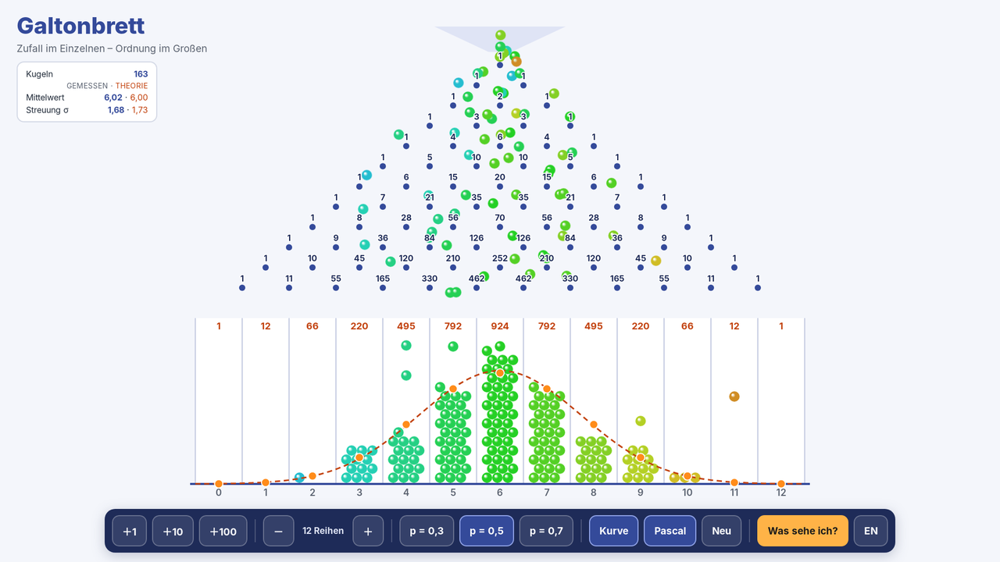

# Galtonbrett - Mathematik interaktiv

Galtonbrett zum Anfassen: Kugeln fallen durch Nagelreihen und bilden die Glockenkurve – Zufall im Einzelnen, Ordnung im Großen.

Umgesetzt nach einem Besuchervorschlag aus der Feedback-Abstimmung am Galadriel-Kiosk
(Mathematisches Institut, Universität Freiburg).

## Screenshot


## Funktionen
- 1, 10 oder 100 Kugeln, 4–20 Reihen, schiefes Brett (p = 0,3 / 0,5 / 0,7)
- Binomial- und Normalverteilung eingeblendet, Pascalsches Dreieck an den Nägeln
- Mittelwert und Streuung: gemessen gegen Theorie
- Erklärung auf Deutsch und Englisch, Vorführmodus ohne Berührung

## Mathematische Konzepte
- Binomialverteilung B(n, p), Binomialkoeffizienten und Pascalsches Dreieck
- Zentraler Grenzwertsatz (Annäherung an die Normalverteilung)
- Gesetz der großen Zahlen; Erwartungswert n·p, Standardabweichung √(n·p·(1−p))

## Projektstruktur

- `index.html`: komplette Anwendung (HTML, CSS, JavaScript in einer Datei, keine externen Ressourcen).
- `show.py`: Python-GTK3/WebKit2-Wrapper für die Vollbildanzeige (X, ESC oder Q schließt).
- `start-galton`: Startskript für den Galadriel-Kiosk.

Reines Canvas-2D. Die Richtung an jedem Nagel ist ein echter Bernoulli(p)-Zufallswurf, die Verteilung ist exakt binomial (χ²-geprüft).

## Starten der Anwendung

### Standalone (lokaler Browser)
`index.html` in einem modernen Webbrowser öffnen.

### Standalone (Vollbild-Fenster)
```bash
python3 show.py
```
Benötigt `python3-gi` und `gir1.2-webkit2-4.1` (Ubuntu 24.04).

### Über Galadriel (Kiosk-Modus)
Als Submodul `galton/` im Galadriel-Repository, Start über `./start galton` bzw.:
```bash
./start-galton
```
